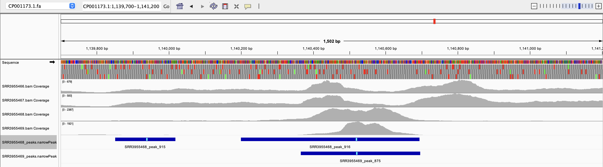

# Assignment 10

## Organism

This is Helicobacter pylori. This is a pathogenic bacterium that causes stomach ulcers. It is able to survive in the stomach acidic environment by secreting ammonia to neutralize the area around itself.

I used 12 single-end ChIP-seq runs in 6 groups with 2 replicates per group: 1 background group and 5 IP conditions. CP001173.1 (G27 strain of H. pylori) is the reference genome.

The control (background) is input DNA, which is sheared chromatin sequenced without immunoprecipitation: SRR3955466 (input_A) and SRR3955467 (input_B). The same input is used as the background for all five conditions.

The five IP conditions (chromatin pulled down with an antibody against the named protein):

| Group | Replicate A | Replicate B | BioProject |
|---|---|---|---|
| HP1043 | SRR3955468 (HP1043-IP_A) | SRR3955469 (HP1043-IP_B) | PRJNA327549 |
| HSPR (wild type) | SRR6351953 (HSPR_wt_A) | SRR6351952 (HSPR_wt_B) | PRJNA421261 |
| Fur_dipyridyl (wild type, dipyridyl treated) | SRR25905507 (Fur_wt_dipyridyl_A) | SRR25905506 (Fur_wt_dipyridyl_B) | PRJNA313048 |
| Fur_iron (wild type, iron treated) | SRR25905511 (Fur_wt_iron_A) | SRR25905510 (Fur_wt_iron_B) | PRJNA313048 |
| NikR_untreated (wild type, no nickel) | SRR3401659 (NikR_wt_ni-_A) | SRR3401754 (NikR_wt_ni-_B) | PRJNA313048 |

## Create files

create design.csv and Makefiles

```bash
touch design.csv
```

```bash
touch Makefile
```

copy and paste contents from the design.csv and makefile from this directory


```bash
make install-tools
```

Run the pipeline from this project directory:

```bash
make all
```

## How many peaks were called in each sample?

```bash
BACKGROUND_GROUP=input
DESIGN=design.csv
PEAK_DIR=peaks

printf '%-16s %s\n' SAMPLE PEAKS
awk -F, -v bg="$BACKGROUND_GROUP" 'NR > 1 && $3 != bg { print $1 }' "$DESIGN" |
while IFS= read -r sample; do
    peak_file="$PEAK_DIR/${sample}_peaks.narrowPeak"
    if [ -f "$peak_file" ]; then
        count=$(wc -l < "$peak_file" | tr -d ' ')
        printf '%-16s %s\n' "$sample" "$count"
    else
        printf '%-16s %s\n' "$sample" MISSING
    fi
done
```

output

```bash
SRR3955468     1388
SRR3955469     1311
SRR6351953      577
SRR6351952     1104
SRR25905507     1410
SRR25905506     1403
SRR25905511     1387
SRR25905510     1274
SRR3401659     1435
SRR3401754      994
```

## How consistent are the peak calls within replicates?

This compares the two samples listed for each non-background group in `design.csv`. Set `BACKGROUND_GROUP` as above; `BEDTOOLS`, `DESIGN`, and `PEAK_DIR` can be overridden if needed. Each analyzed group should have exactly two samples.

```bash
BACKGROUND_GROUP=input
awk -F, -v bg="$BACKGROUND_GROUP" 'NR>1 && $3!=bg {if (!($3 in first)) first[$3]=$1; else print first[$3],$1}' design.csv |
while read -r a b; do
  fa="peaks/${a}_peaks.narrowPeak"; fb="peaks/${b}_peaks.narrowPeak"
  na=$(wc -l < "$fa" | tr -d ' '); nb=$(wc -l < "$fb" | tr -d ' ')
  sa=$(bedtools intersect -a "$fa" -b "$fb" -u | wc -l | tr -d ' ')
  sb=$(bedtools intersect -a "$fb" -b "$fa" -u | wc -l | tr -d ' ')
  printf '%s vs %s: %s%%, %s%% overlap\n' "$a" "$b" "$((100*sa/na))" "$((100*sb/nb))"
done
```

Output:

```bash
SRR3955468 vs SRR3955469: 75%, 86% overlap
SRR6351953 vs SRR6351952: 68%, 44% overlap
SRR25905507 vs SRR25905506: 92%, 86% overlap
SRR25905511 vs SRR25905510: 85%, 93% overlap
SRR3401659 vs SRR3401754: 58%, 82% overlap
```

### IGV

Load the configured reference genome:

Agreement:

Peak calls A's in peak_916 spans roughly 1,140,200 thru 1,140,690 and B's peak_875 spans roughly 1,140,520 thru 1,140,695

Disagreement:

Peak_915 spanning roughly 1,139,850 thru 1,140,020 is only visible in A, but not B


